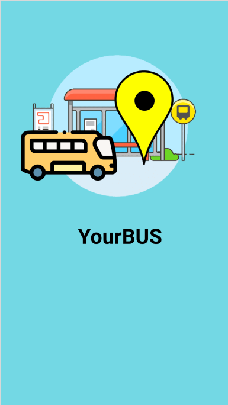
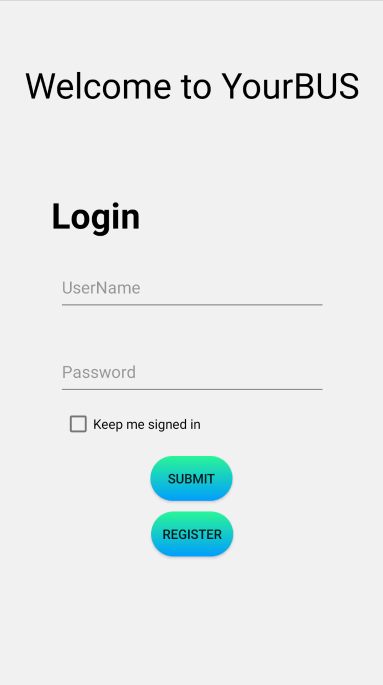
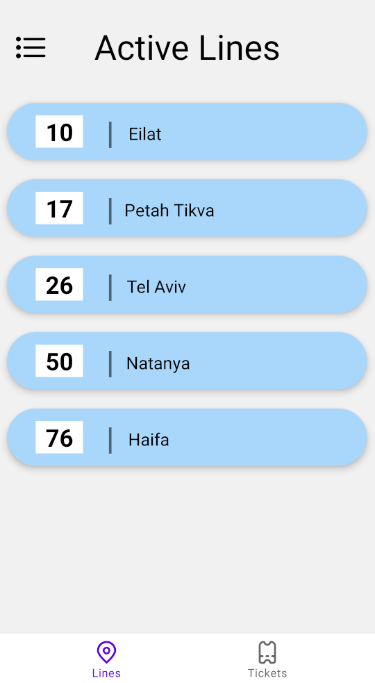
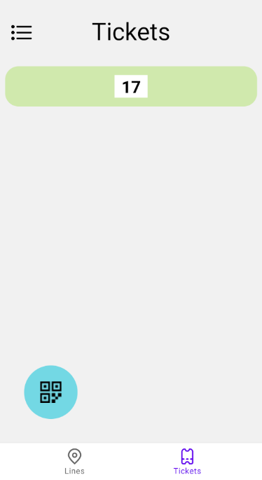
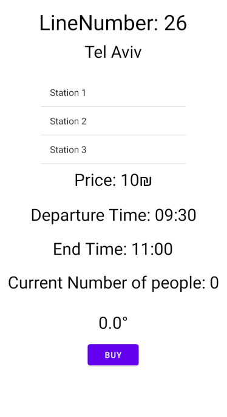
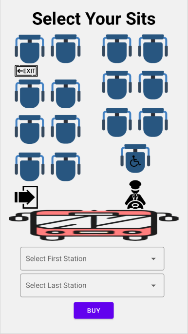
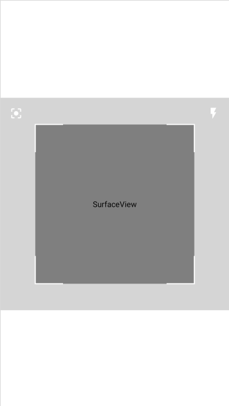
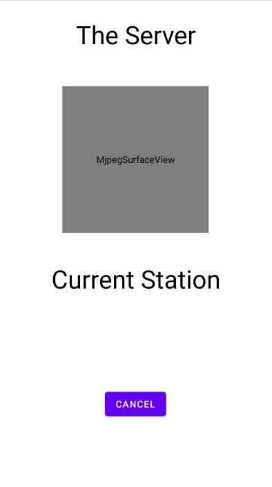
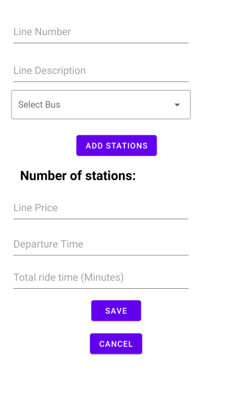
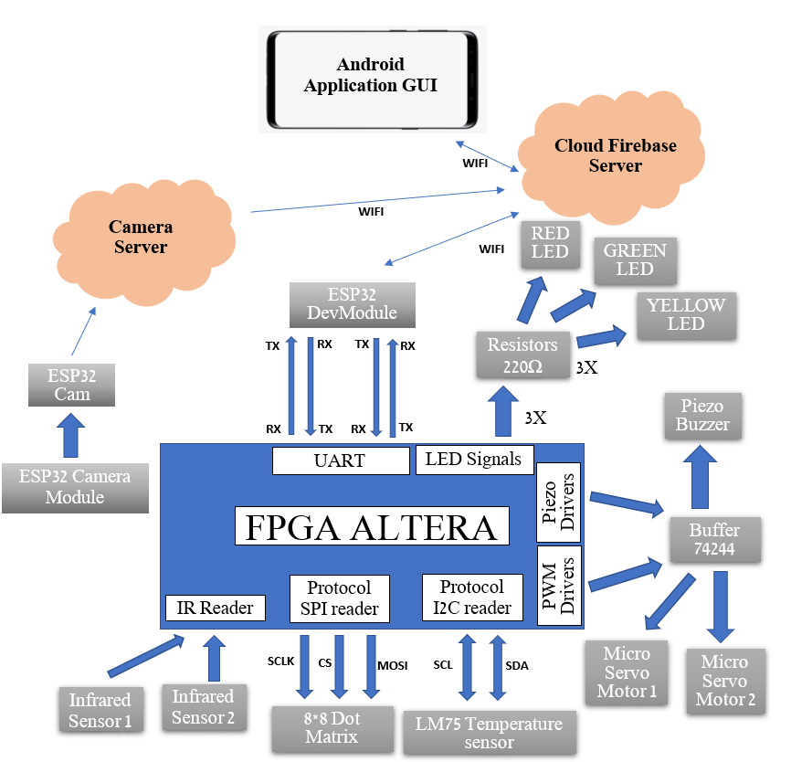

# YourBUS — Smart Bus Android & IoT System

**A Java Android application connected to a physical smart-bus prototype through Firebase Realtime Database.**

**Academic capstone project · April 2023 · Electrical & Electronics Engineering Technician program (Electronic Systems track)**  
**Developed by Alik Minenko**

> **Project status:** Educational prototype. This repository documents the original 2023 implementation; it is not a commercial transport, ticketing, or payment service. Some features require the original hardware and Firebase data structure.

## Overview

YourBUS is a proof-of-concept smart public-transport system developed to demonstrate the integration of **native Android development, cloud data synchronization, embedded systems, and FPGA-based control**.

The Android app provides route information, a ticket-reservation flow, seat selection, QR-based bus identification, and a separate administration interface. A physical bus model uses sensors, microcontrollers, and an FPGA to monitor passengers and environmental conditions. **Firebase Realtime Database** exchanges information between the app and the embedded system.

The project also includes a dedicated Android-based monitoring screen that reads frames from an **ESP32-CAM video stream**, performs **text recognition (OCR)** on selected frames to identify bus-stop names, and updates the shared database for the prototype's station-aware logic.

## Android app highlights

### Passenger experience

- **Login and registration** with a Firebase-backed user-data flow, plus a password-change screen and a "keep me signed in" option in the original implementation.
- **Live route list** and detailed route information: route number, description, stops, departure/arrival information, fare, passenger count, and bus temperature.
- **Ticket reservation workflow:** select boarding and drop-off stops, then choose seats from a **15-position seat map**, including a marked accessible seat. The prototype limits a reservation to **four seats**.
- **Tickets screen** showing the user's reservations, selected seats, and boarding/drop-off stations.
- **QR scanning** using the phone camera to identify a bus and initiate the prototype's boarding/validation flow.

### Administration and monitoring

- Separate **user and administrator navigation** in the original app.
- Administration screens for **adding buses and creating/removing routes**, with station lists, bus association, scheduling information, and fare settings.
- An Android **monitoring / "server" activity** that receives the camera stream, runs OCR on captured frames, and writes the recognized station text to Firebase.
- Prototype logic for boarding/alighting events, passenger counting, next-stop alerts, and door-control commands sent through the connected hardware.

> **Ticketing note:** "Buy" in the original UI represents the prototype's ticket-selection / reservation workflow. The project documentation does not establish integration with a real payment processor.

## App screenshots

The images below were extracted from the original 2023 project report. They show the **documented prototype UI**, not a redesigned or updated release.

| Welcome / splash | Login | Available routes |
|:---:|:---:|:---:|
|  |  |  |

| My tickets | Route details | Seat selection |
|:---:|:---:|:---:|
|  |  |  |

| QR scanner | OCR monitoring | Add a route |
|:---:|:---:|:---:|
|  |  |  |

## Technology stack

| Layer | Technologies used in the project |
|---|---|
| Android app | **Java**, **Android Studio**, XML layouts, Activities, Fragments, RecyclerView, adapters, dialogs |
| Cloud data | **Firebase Realtime Database**, real-time listeners |
| Android integrations | Camera-based QR scanning, frame-based text recognition (OCR), network video display |
| Embedded software | **ESP32**, C/C++-style microcontroller firmware, Wi-Fi communication |
| Digital logic | **DE10-Lite / Intel MAX 10 FPGA**, **VHDL** |
| Hardware and communication | **UART**, **I²C**, **SPI**, IR sensors, LM75 temperature sensor, ESP32-CAM, servos, LEDs, piezo buzzer |

## System architecture

**Data flow at a glance:**

1. Sensors and actuators connect to the **FPGA (DE10-Lite / MAX 10)**; VHDL controls counting, signaling, and model hardware behavior.
2. The **ESP32** exchanges data with the FPGA via **UART** and synchronizes relevant values with **Firebase Realtime Database** using Wi-Fi.
3. The **Android app** listens for database updates and displays route and bus information; user actions update the shared prototype state.
4. The **ESP32-CAM** serves a video feed. The Android monitoring activity performs OCR on sampled camera frames and writes recognized station text back to Firebase.
5. The prototype uses the updated station and passenger state to drive simulated bus-door actions and passenger alerts through the hardware.

The OCR processing described in the report runs **inside the Android monitoring activity**; it is **not** a standalone, always-on cloud OCR service.

## Code organization

The Android source described in the project documentation includes the following key classes:

| Class | Responsibility |
|---|---|
| `SplashActivity` | Intro / splash screen and app entry |
| `LoginActivity` | Original sign-in and registration flow |
| `MainActivity` | Main navigation and password-change dialog |
| `LinesFragment` / `LineAdapter` | Display and select available bus routes |
| `TicketsFragment` / `TicketAdapter` | Ticket list, reservation details, and QR entry point |
| `LineInfo` | Route details, live readings, and seat-selection flow |
| `QrActivity` | Camera-based QR scanning and result handling |
| `AddBus` / `AddLine` | Administrator bus and route forms |
| `ServerActivity` | Camera stream, OCR, and prototype monitoring logic |
| `Bus`, `Line`, `Ticket`, `User` | Data models and shared application data |

These names are taken from the **original project report**. The checked-in Android Studio project is the source of truth for actual package paths and current build configuration.

## Technical documentation

The [technical documentation index](docs/README.md) expands the explanations in the original Hebrew capstone report into English guides **cross-checked against this repository's Java/XML source**. Follow the implementation from architecture to Android UI, database integration and the IoT prototype.

| Walkthrough | Source-level focus |
|---|---|
| [Architecture](docs/architecture.md) | Android, Firebase, ESP32-CAM, ESP32 and FPGA |
| [Navigation and Android UI](docs/android-navigation.md) | Activities, fragments, RecyclerView and XML |
| [Login and sessions](docs/authentication.md) | Registration, remembered login and security limitations |
| [Firebase data model](docs/firebase-data-model.md) | Bus, Line, Ticket, users, paths and listeners |
| [Ticket booking](docs/ticket-booking.md) | Stations, 15-seat map and reservation writes |
| [QR boarding](docs/qr-boarding.md) | Scan callback and boarding checks |
| [Camera and OCR](docs/camera-ocr.md) | MJPEG capture, ML Kit and station events |
| [Administrator workflows](docs/admin-workflows.md) | Creating buses/routes and station lists |
| [Testing and limitations](docs/testing-and-limitations.md) | Reproducibility, security and engineering backlog |

> **Attribution:** The original report was a joint capstone by **Alik Minenko and Nimrod Saban**. Documentation preserves the project's original technical explanations while omitting the full report, which contains personal details.

## Getting started

### Requirements

- Android Studio with a compatible Android SDK and the project's Gradle toolchain.
- An Android device or emulator; a physical device is needed for a realistic camera / QR demo.
- **Your own Firebase project** with a configured Realtime Database.
- The original electronics prototype **only** for end-to-end hardware demonstrations.

### Local setup

1. Clone the repository and open the Android project root in **Android Studio**.
2. Let Gradle sync and install any SDK components requested by Android Studio. The project dates to **2023**, so Gradle or dependency updates may be needed on a current toolchain.
3. Create a Firebase project for a **test/demo environment**, register the Android application with its *actual application ID*, and place your generated `google-services.json` in the `app/` module if required by the checked-in configuration.
4. Configure **Firebase Realtime Database security rules** and use **dummy accounts/data only**. The original app expects project-specific nodes for users, routes, buses, tickets, and occupancy; **the original database content is not included** in this repository.
5. Run the app from Android Studio. Features that depend on live bus data, the camera URL, and FPGA/ESP32 signals will not operate without appropriate demo data or the original hardware.

> This README does **not** claim the historical source has been rebuilt or tested against current Android versions. Verify the build and update the instructions after running it locally.

## Security and implementation notes

This is an **academic prototype**, and the original implementation requires a security review before any public deployment:

- The project report describes **password comparison against values stored in Realtime Database** and username-based administrator checks. **Do not use this as production authentication or authorization.** Migrate to Firebase Authentication, enforce access with Firebase Security Rules, and avoid storing raw passwords.
- Inspect source files **and Git history** for embedded database URLs, credentials, access tokens, personally identifying information, and hard-coded device addresses before making the repository public. A `.gitignore` does not remove secrets from existing commits.
- Keep signing keys, local configuration, private credentials, and any real user records outside the public repository. A Firebase configuration file is not a substitute for secure database rules.
- The report documents an **example bus identifier** and fixed-size seat representation; these are prototype assumptions, not a general production architecture.
- Do not assume real payments, production-level privacy controls, automated tests, or continuous background OCR: those are **not established by the original documentation**.

## Project background

This project was submitted in **April 2023** as a final capstone in the **Electrical & Electronics Engineering Technician program (Electronic Systems track) at Kinneret Technological College**, under the topic *Passenger Mapping and Alerts on a Bus Using IoT Technology*.

It was developed by **Alik Minenko and Nimrod Saban**, under the supervision of **Eyal Havarbar** (name transliterated from the Hebrew report). The original report documents the electronics, firmware, VHDL logic, Android screens, Java/XML source, integration, troubleshooting, and testing.
