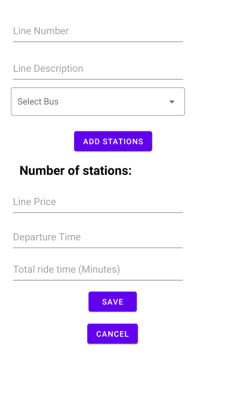

# Administration: Bus and Route Setup

[Documentation index](README.md)

The original report documents separate user and admin menus, an **Add Bus** screen, an **Add Line** screen and a station-entry dialog (PDF pp. 123–125 and 164–176). The current implementation uses [MainActivity.java](../app/src/main/java/com/example/busproject/MainActivity.java), [AddBus.java](../app/src/main/java/com/example/busproject/AddBus.java) and [AddLine.java](../app/src/main/java/com/example/busproject/AddLine.java).

## Menu visibility

`MainActivity` shows `addline`, `addbus` and `devtest` menu items when `User.getUserName()` equals `admin`. This is a **client-side UI convention only**; it does not constitute protected administrator authorization.

## Adding a bus

[AddBus.java](../app/src/main/java/com/example/busproject/AddBus.java) collects a bus identifier and a camera host/IP, checks the `Buses` node, and creates a `Bus` instance in Firebase.

The `Bus` model initializes seat availability with 15 `false` flags, an available status, the stream host, and default fields for passenger count, temperature and control signals.

## Creating a route

[AddLine.java](../app/src/main/java/com/example/busproject/AddLine.java) collects:

- Route number and description
- Associated available bus
- Ordered list of stations
- Departure time and ride duration
- Fare information

A dialog allows the operator to add and remove stations. A time-picker dialog records the departure time. Saving a route writes a `Line` model to `Lines/{lineNumber}` and marks the associated bus as unavailable in the `Buses` node.

## Removing a route

In [LineInfo.java](../app/src/main/java/com/example/busproject/LineInfo.java), the admin route removal path deletes the line record and marks its assigned bus as available again.

## Engineering notes

- No trusted server-side authorization flow is demonstrated by the admin UI.
- Route creation and bus availability changes are separate database writes, which may become inconsistent on failure.
- Validation is mainly implemented in the activity layer rather than in a centralized domain model.
- Bus IDs, line IDs and command values follow original prototype conventions.

This part of the capstone is valuable as a demonstration of Android forms, dialogs, Firebase writes, and dynamic navigation, but must be hardened before use with real users.
