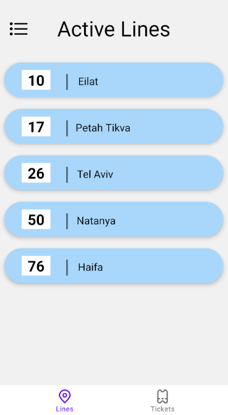

# Android Navigation and UI Structure

[Documentation index](README.md)

The original report documents the individual XML layouts and then explains how each Java activity or fragment connects to its views (report PDF pp. 123–130 and 141–153). The checked-in project uses **Java, XML layouts, Activities, Fragments, and RecyclerView** rather than a Jetpack Compose interface.

## Entry screen: `SplashActivity`

Source: [SplashActivity.java](../app/src/main/java/com/example/busproject/SplashActivity.java) · [activity_splash.xml](../app/src/main/res/layout/activity_splash.xml)

The splash activity shows animated bus, location-pin and title elements. A `Handler` introduces an approximately four-second transition. The code reads the `LoggedIn` SharedPreferences file:

- `loggedin` decides whether to open `MainActivity` or `LoginActivity`.
- `username` and `email` populate the static `User` holder when present.
- Animations are loaded from `res/anim`.

This is a **local remembered-session check**, not evidence that a valid Firebase authentication session was revalidated.

## Main screen and navigation

Source: [MainActivity.java](../app/src/main/java/com/example/busproject/MainActivity.java) · [activity_main.xml](../app/src/main/res/layout/activity_main.xml)

The main activity inflates `ActivityMainBinding` (View Binding), initializes the route fragment, and provides two navigation mechanisms:

1. **Bottom navigation:** switches between `LinesFragment` and `TicketsFragment`, with slide animations.
2. **Navigation drawer:** exposes route/bus administration options for the username `admin`, plus password change and logout.

The report explains the visual distinction between the regular-user and administrator navigation menus. The role distinction is implemented in the client by comparing usernames; see [authentication](authentication.md) for why that is insufficient as a security boundary.

## Route list

Source: [LinesFragment.java](../app/src/main/java/com/example/busproject/LinesFragment.java) · [LineAdapter.java](../app/src/main/java/com/example/busproject/LineAdapter.java)

- The fragment creates a `RecyclerView` and `LinearLayoutManager`.
- A Firebase `ValueEventListener` populates an `ArrayList<Line>` from the `Lines` node.
- `LineAdapter` binds each line to a row layout and forwards click events to the fragment.
- Clicking a route opens [LineInfo.java](../app/src/main/java/com/example/busproject/LineInfo.java) with selected route fields and the station list passed using `Intent` extras.

## Ticket list

Source: [TicketsFragment.java](../app/src/main/java/com/example/busproject/TicketsFragment.java) · [TicketAdapter.java](../app/src/main/java/com/example/busproject/TicketAdapter.java)

This fragment uses the same adapter pattern for a user's tickets, displays an empty state when needed, opens ticket-detail dialogs and starts the QR scanner. A bus-seat listener updates the seat diagram in the ticket details.

## Layout-to-code connections

| Feature | Java entry point | Layout |
|---|---|---|
| Splash | [SplashActivity](../app/src/main/java/com/example/busproject/SplashActivity.java) | [activity_splash.xml](../app/src/main/res/layout/activity_splash.xml) |
| Login | [LoginActivity](../app/src/main/java/com/example/busproject/LoginActivity.java) | [activity_login.xml](../app/src/main/res/layout/activity_login.xml) |
| Main navigation | [MainActivity](../app/src/main/java/com/example/busproject/MainActivity.java) | [activity_main.xml](../app/src/main/res/layout/activity_main.xml) |
| Routes | [LinesFragment](../app/src/main/java/com/example/busproject/LinesFragment.java) | [fragment_lines.xml](../app/src/main/res/layout/fragment_lines.xml) |
| Tickets | [TicketsFragment](../app/src/main/java/com/example/busproject/TicketsFragment.java) | [fragment_tickets.xml](../app/src/main/res/layout/fragment_tickets.xml) |

## Engineering notes

This structure makes the original project easy to explore because screen names correspond closely to Java classes and XML layouts. For a modernized implementation, state restoration, lifecycle-aware observers, and separating Firebase calls from UI code would help make behavior more predictable.
