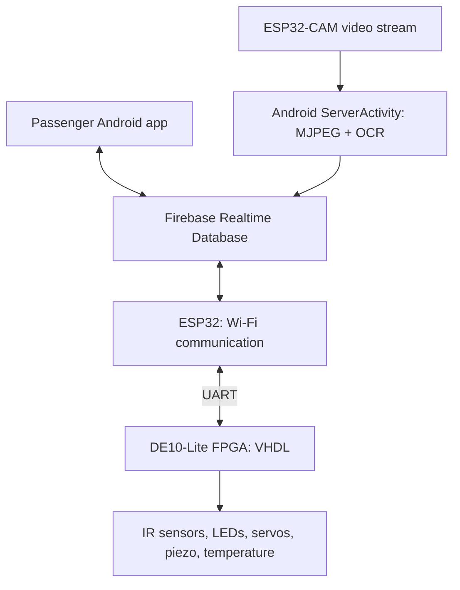
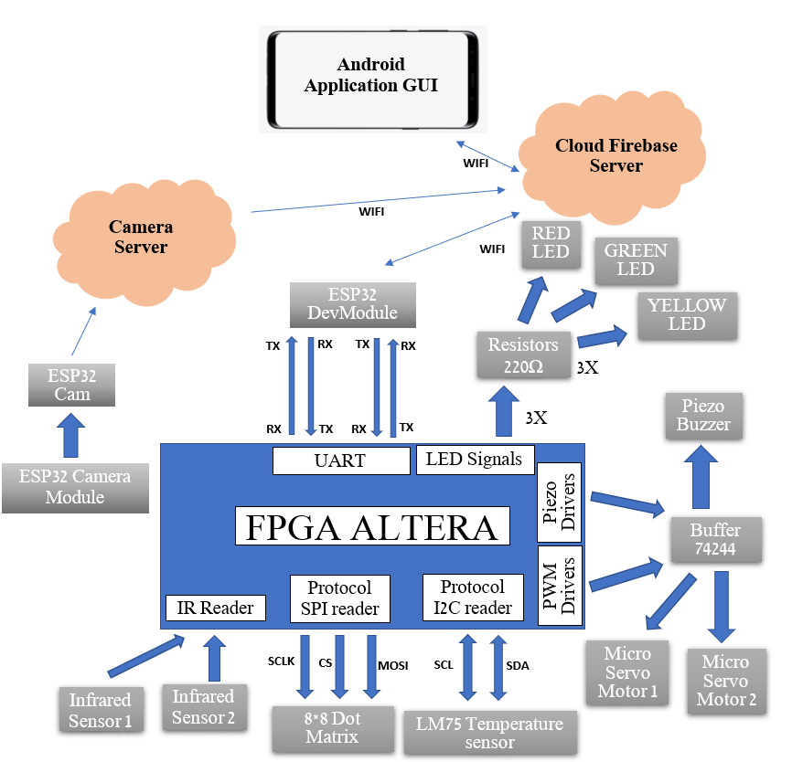

# System Architecture

[Documentation index](README.md) · [Project overview](../README.md)

The original report describes a smart-bus model that combines a native Android app, a shared Firebase Realtime Database, an ESP32 Wi-Fi interface, an ESP32-CAM, and an FPGA-based control system. The objective is to map passengers and coordinate station-aware alerts in an **educational IoT prototype** (report PDF pp. 6, 11–12 and 44).

## Components and responsibilities

| Component | Responsibility in the original design |
|---|---|
| Android client (Java/XML) | Route and ticket UI, account screens, QR scanning, passenger actions |
| Firebase Realtime Database | Shared state for users, tickets, routes, seats, bus telemetry and commands |
| ESP32 | Wi-Fi/database connection and communication with the FPGA |
| DE10-Lite / MAX 10 FPGA | VHDL-controlled prototype logic, sensors and model outputs |
| ESP32-CAM | MJPEG camera stream, consumed by the Android monitoring screen |
| Android monitoring activity | Captures camera frames, runs OCR and updates bus station state |

## Logical data flow

The diagram is a **conceptual explanation** based on the report. It does not establish that all communication paths are secured, that the database is hosted privately, or that processing continues when the Android monitoring activity is closed.

## Example: database-to-UI updates

In [LinesFragment.java](../app/src/main/java/com/example/busproject/LinesFragment.java), a Firebase listener observes the `Lines` node and updates a `RecyclerView` adapter when the snapshot changes. In [LineInfo.java](../app/src/main/java/com/example/busproject/LineInfo.java), a listener reads the selected bus's passenger count, temperature, and seat state.

The opposite direction is also present: [AddLine.java](../app/src/main/java/com/example/busproject/AddLine.java) writes a new route to `Lines`, while [TicketsFragment.java](../app/src/main/java/com/example/busproject/TicketsFragment.java) can write a boarding command under `Buses/{busId}/functions` after the QR flow.

## Example: camera-to-station update

[ServerActivity.java](../app/src/main/java/com/example/busproject/ServerActivity.java) retrieves the camera host from the bus's `live` field, connects to an HTTP MJPEG stream on port 81, converts sampled frames to ML Kit `InputImage` objects and stores recognized text under the bus's `currentST` field.

**Important distinction:** the ESP32-CAM provides video; **Android performs the OCR** in the existing code. There is no independent, always-running cloud OCR worker in this repository.

## Communication and assumptions

The academic system uses several protocols at different layers: Wi-Fi and Firebase between the app/ESP32, UART between the ESP32 and FPGA, and peripheral interfaces described in the hardware chapters (for example, I²C for the temperature-related subsystem). The Android repository does **not** include the complete ESP32 and VHDL firmware used in the full physical demonstration.

The app expects project-specific database paths and a physical camera/hardware setup. A Firebase test project without matching demo data will not reproduce the complete system automatically.

## Improvements to consider

- Separate Android data access from activity/fragment UI logic.
- Introduce typed repositories, lifecycle-aware state and structured error handling.
- Authenticate users with Firebase Authentication and enforce security rules.
- Represent hardware commands as an explicit, validated protocol rather than unexplained numeric values.
- Use a secure or carefully restricted transport for camera streaming.
