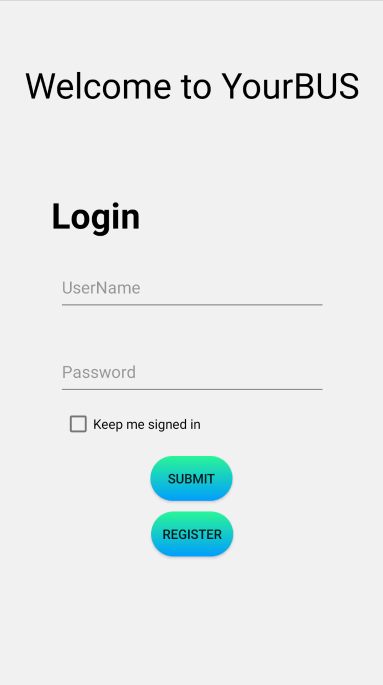

# Login and Registration

[Back to documentation](README.md)

**Report reference:** PDF pages 131–140, 144–149 and 205.

[Java: LoginActivity.java](../app/src/main/java/com/example/busproject/LoginActivity.java) · [XML: activity_login.xml](../app/src/main/res/layout/activity_login.xml)

## Login

The user enters a username and a password. The application checks that neither field is empty, then reads the user's information from **Firebase Realtime Database**.

In the original code, the password entered by the user is compared with the `Password` value stored in Firebase. If they match, the app opens the main screen.

For the username `server`, the application opens the monitoring screen instead.

## Registration

The **Register** button opens a dialog where the user enters:

- Username
- Email
- Password
- Password confirmation

The Java code checks the input, checks whether the username or email already exists, and writes the new user's details into Firebase.

## Remember me

The login screen also has a checkbox for remembering the login. When the user chooses it, the application stores a login flag, username and email using `SharedPreferences`.

[SplashActivity.java](../app/src/main/java/com/example/busproject/SplashActivity.java) reads that information when the app opens.

**Note about the original code:** This page describes the login method implemented in the 2023 educational project. It stores and compares password values in Firebase; it is **not** a login system intended for real users or production use.
