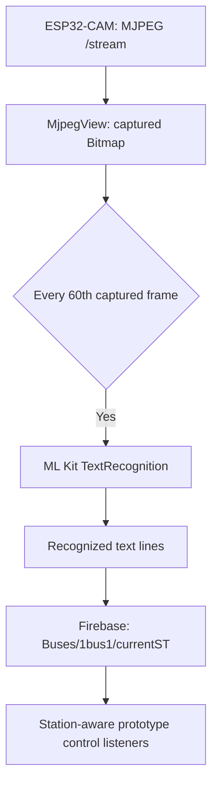
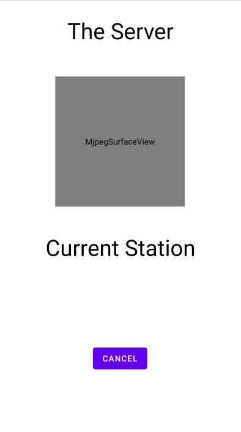

# ESP32-CAM Stream, OCR and Station-Aware Control

[Documentation index](README.md)

The original report's monitoring chapter explains how the model bus uses a camera feed and recognized station text to coordinate passenger-related events (PDF pp. 194–202). The actual code is in [ServerActivity.java](../app/src/main/java/com/example/busproject/ServerActivity.java).

**Important:** This is an Android activity acting as the prototype's *server/monitoring screen*. The existing repository does **not** implement a 24/7 standalone backend, an on-device OCR library running on the ESP32, or autonomous processing after the Android app is closed.

## Stage 1 — Connect to the camera

The monitoring activity listens to `Buses/1bus1/live` in Firebase to obtain the camera's host/IP. It then opens an MJPEG feed at an HTTP URL with port **81** and the path `/stream`, using the `ipcam-view` library.

The stream is shown in a `MjpegView`. The camera address is provided through database state rather than fixed in the Java method, although the bus ID is hard-coded.

## Stage 2 — Recognize text from captured frames

The view's `OnFrameCapturedListener` receives decoded `Bitmap` frames. The source creates an ML Kit `TextRecognizer` using `TextRecognizerOptions.DEFAULT_OPTIONS` and constructs an `InputImage` for each captured frame.

A frame counter triggers recognition when the count reaches **60**, then resets. This is sampling by **frame count**, not by a guaranteed number of seconds.

The successful recognition callback iterates over detected text blocks and lines. Each detected line is written to `Buses/1bus1/currentST`, and the current-station text view is updated.

## Stage 3 — Respond to bus and ticket state

The activity contains several Firebase listeners. The original report discusses:

- A `LinkedHashMap` associating stations with passenger names and expected drop-off counts.
- Passenger boarding logic based on the current user, their ticket and current seat/passenger state.
- Control values written to `functions` for simulated doors, LEDs and audible alerts.
- Monitoring the `goingdown` flag and passenger count to coordinate drop-off behavior.
- Clearing relevant tickets and seat occupancy after passengers are considered to have left the bus.

These are **prototype control assumptions**, not general transit-safety rules. They rely on specific Firebase paths and the connected ESP32/FPGA model.

## Engineering limitations and improvements

1. **OCR confidence and station matching:** The current implementation writes recognized lines directly to `currentST` without robust normalization or a confirmed match to a known stop.
2. **Asynchronous errors:** Some recognition and database error callbacks have no recovery handling.
3. **Processing lifetime:** An activity-based monitoring screen is not an independently durable background service.
4. **Network security:** The video uses local HTTP and the Android manifest permits cleartext traffic.
5. **Coupling:** UI display, stream management, OCR and device-state logic are combined in one large activity.
6. **Hard-coded bus identity:** Several listeners target `1bus1`.
7. **Resource management:** Stream and recognizer lifetimes should be checked carefully for repeated listener changes and activity shutdown.

This document records what the 2023 prototype demonstrates: Android camera streaming, ML Kit text recognition and database-driven hardware integration. It does not claim the OCR is safety-critical, continuous, or production-ready.
