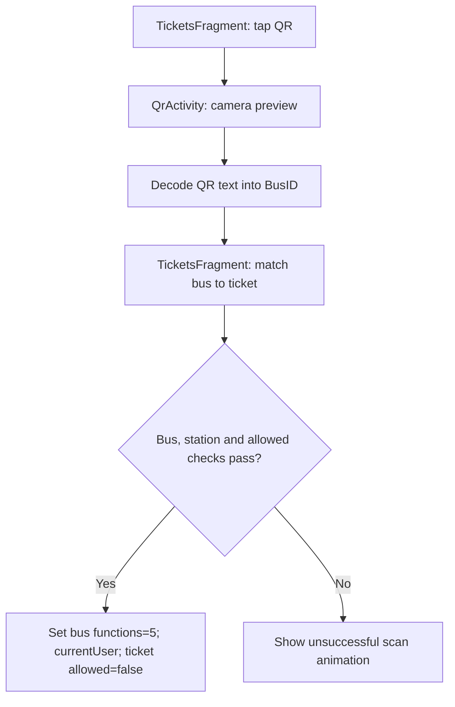

# QR Scanning and Boarding Validation

[Documentation index](README.md)

The report describes a QR scan screen and a bus-boarding verification flow (PDF pp. 157–163 and 191–193). The implementation spans [QrActivity.java](../app/src/main/java/com/example/busproject/QrActivity.java) and [TicketsFragment.java](../app/src/main/java/com/example/busproject/TicketsFragment.java).

## Scanning screen

`QrActivity` creates a `CodeScanner` object, selects the back-facing camera, configures continuous scanning and supplies a decode callback. The application requests the Android `CAMERA` permission when needed, starts preview in `onResume`, and releases camera resources in `onPause`.

On a successful decode, the activity places the **scanned text** in the returning `Intent` as `BusID` and finishes. The scanner itself **does not authenticate the passenger** and does not validate the bus; that logic runs in the ticket fragment.

## Validation performed by the current implementation

After receiving the `BusID` result, `TicketsFragment` attempts to:

- Find a ticket whose `bus` matches the scanned bus ID.
- Read the current station `currentST` and the Boolean `goingdown` state.
- Compare the ticket's pickup station with the bus's current station.
- Check the ticket's `allowed` flag.
- When those checks succeed, write a command value to `Buses/{busId}/functions`, record the current username in `currentUser`, and mark the ticket as no longer allowed.

The original project uses `functions = 5` as a command in the prototype's hardware-control flow. This is a design-specific numeric value, not a standardized transit protocol.

## Limitations found in the reviewed code

- **Possible out-of-range access:** `TicketsFragment` references `ticketlist.get(helper)` even when there is no matching ticket, so a failed bus match can select an invalid ticket or wrong data.
- **Client-side validation:** Checking a QR string and writing control flags from a client is not sufficient proof of boarding authorization.
- **Non-atomic updates:** Updating multiple Firebase locations separately can leave partial states after a network failure.
- **Permissions and lifecycle:** Camera permission handling must be tested on modern Android versions, especially denial and retry behavior.
- **Static test bus assumption:** An admin branch contains a hard-coded `1bus1` ID.

For a real deployment, a trusted backend should validate ticket ownership, trip/station, replay prevention and permission before issuing a hardware instruction.
