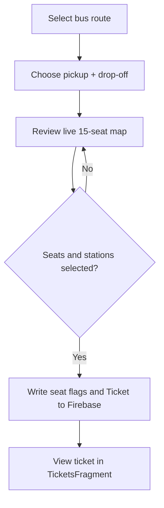
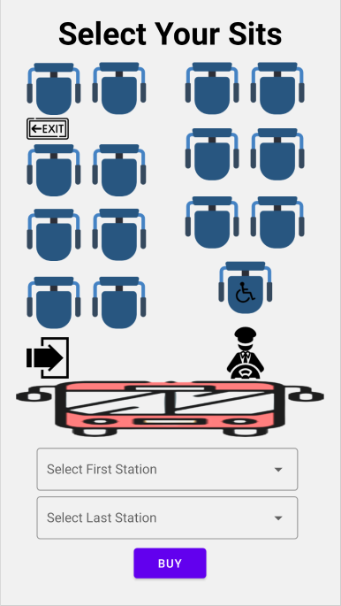

# Ticket Booking and Seat Selection

[Documentation index](README.md)

The report devotes a section to the route detail screen and the ticket-selection dialog (PDF pp. 177–190). In the checked-in code, the main flow is implemented by [LineInfo.java](../app/src/main/java/com/example/busproject/LineInfo.java), [Ticket.java](../app/src/main/java/com/example/busproject/Ticket.java), and [TicketsFragment.java](../app/src/main/java/com/example/busproject/TicketsFragment.java).

> **Terminology:** The original interface uses the word *buy*. The source shows a **prototype reservation flow**, not a payment gateway or actual charge.

## User journey

1. The passenger selects a route in [LinesFragment](../app/src/main/java/com/example/busproject/LinesFragment.java).
2. `LineInfo` displays line details and real-time bus information, including passenger count and temperature.
3. The passenger opens the booking dialog, chooses a **pickup station**, and then chooses a **drop-off station** after the pickup.
4. A 15-position visual seat map indicates occupied and free seats based on Firebase `Buses/{busId}/places`.
5. The passenger selects between **one and four seats**.
6. Confirming the booking writes occupied seat flags and creates a `Ticket` object under the current user's `Tickets` node.
7. The reservation appears in the tickets fragment.



## Seat state and UI

The `Bus` model initializes `places` as **15 false values**. In `LineInfo`, the selected bus's `places` node is observed with a Firebase listener. The screen changes the appearance of occupied seats and disables their buttons. The final index has a distinct accessible-seat graphic.

The click handler tracks selected positions using a Boolean array and a counter. When the count reaches four, selecting another free seat shows the message **"You can choose only up to 4 sits"** in the original prototype.



## Example: storing a reservation

The existing code uses the following operations (simplified for explanation; **not** a verbatim code excerpt):

```java
// Conceptual summary of LineInfo.java's booking branch
for (int i = 0; i < selectedSeats.length; i++) {
    if (selectedSeats[i]) {
        busSeats.child(String.valueOf(i)).setValue(true);
        seatPositions.add(String.valueOf(i));
    }
}
Ticket ticket = new Ticket(
    busId, pickupStop, dropoffStop, seatCount, lineNumber, seatPositions, true
);
userTickets.child(lineNumber).setValue(ticket);
```

Compare with the actual [LineInfo.java booking handler](../app/src/main/java/com/example/busproject/LineInfo.java) for current variable names and implementation.

## Ticket details

[TicketsFragment.java](../app/src/main/java/com/example/busproject/TicketsFragment.java) listens to the current user's ticket records. It uses `TicketAdapter` to render ticket rows, opens a detailed dialog, and highlights the current user's seats on the seat map. It also provides the QR entry point for boarding.

## Important limitations

- **Race condition:** Individual seat writes and the user-ticket write are separate operations. Two devices may attempt to reserve the same position concurrently.
- **Database rules:** The client-side seat limit does not replace authoritative server-side validation.
- **Indexing:** There is no evidence of transaction-safe capacity enforcement in the reviewed reservation handler.
- **Ticket identity:** Tickets are stored under the route number; the original format does not support arbitrarily many independent reservations for the same route.
- **Payment:** No real checkout or payment-provider integration is documented.

For production use, reserve seats atomically with database transactions or a trusted backend and protect all writes through user-scoped authorization rules.
